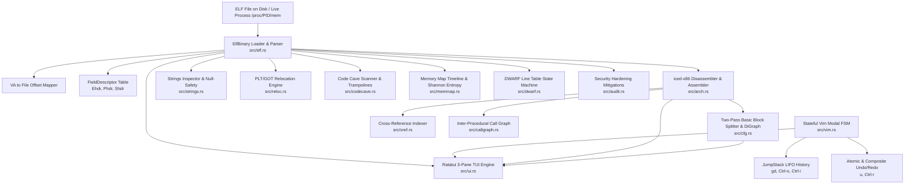

# velf ⚡
### Modal, Terminal-Based ELF Binary Inspector, Reverse-Engineering Suite & Live Patcher

[](https://www.rust-lang.org/)
[](LICENSE)
[-red.svg)]()
[]()

`velf` is a high-performance, keyboard-driven terminal application that brings **modal Vim editing conventions** to **ELF binary reverse-engineering, structural inspection, and live machine code patching**. 

Built from the ground up in Rust with `goblin`, `ratatui`, `iced-x86`, `petgraph`, `gimli`, and `nix`, `velf` bridges the gap between static disassemblers (IDA, Ghidra, radare2), structural hex editors, and interactive debuggers (GDB).

```
┌── Sections (SHF_EXECINSTR) ─┐┌── [2] Disassembly (x86_64 Intel) ───────────────┐┌── [3] Hex / ASCII Dump ──────┐
│  0     .interp    0x00400318 ││ 0x00401120  48 83 ec 08        sub     rsp, 0x8 ││ 001120  48 83 ec 08 e8 1b fe ff  H....... │
│  1     .note.gnu  0x00400338 ││ 0x00401124  e8 1b fe ff ff     call    0x400f44 ││ 001128  ff 48 83 c4 08 c3 66 2e  .H...f.  │
│ 13 [X] .text      0x00401060 ││ 0x00401129  48 83 c4 08        add     rsp, 0x8 ││ 001130  0f 1f 84 00 00 00 00 00  ........ │
│ 14     .rodata    0x00402000 ││ 0x0040112d  c3                 ret              ││ 001138  f3 0f 1e fa 48 83 ec 08  ....H... │
└──────────────────────────────┘└────────────────────────────────────────────────┘└───────────────────────────────┘
-- NORMAL -- velf | Off: 0x001124 | VA: 0x00401124 | Press '?' for help, ':' for command mode
```

---

## 📑 Table of Contents
1. [Core Architecture & System Design](#-core-architecture--system-design)
2. [Key Features](#-key-features)
3. [Vim Keybinding Matrix](#-vim-keybinding-matrix)
4. [Command Mode Reference](#-command-mode-reference)
5. [In-Depth Systems Engineering & Deep Dives](#-in-depth-systems-engineering--deep-dives)
   - [Virtual Address to File Offset Translation](#1-virtual-address-to-file-offset-translation)
   - [In-Place Machine Code Patching & Safety](#2-in-place-machine-code-patching--safety)
   - [Automated Code Cave Trampolines](#3-automated-code-cave-trampolines)
   - [PLT / GOT Dynamic Linking & Hook Redirection](#4-plt--got-dynamic-linking--hook-redirection)
   - [Control-Flow Graph (CFG) Construction](#5-control-flow-graph-cfg-construction)
   - [Shannon Entropy & Memory Layout Timeline](#6-shannon-entropy--memory-layout-timeline)
   - [Binary Security Hardening Auditing](#7-binary-security-hardening-auditing)
6. [Compilation & Installation](#-compilation--installation)
7. [Contributing & Code Style](#-contributing--code-style)

---

## 🏛 Core Architecture & System Design

`velf` is engineered as a decoupled, modular system with synchronized views centered around a single source of truth:



| Module | Purpose | Key Technologies |
| :--- | :--- | :--- |
| [`src/elf.rs`](file:///home/hvsr/dev/projects/rs/velf/src/elf.rs) | ELF Header, Segment, Section, and Symbol Table parser; physical offset mapper. | `goblin::elf` |
| [`src/arch.rs`](file:///home/hvsr/dev/projects/rs/velf/src/arch.rs) | Intel-syntax x86_64 disassembler, instruction parser, in-place NOP-sled safety. | `iced-x86` |
| [`src/cfg.rs`](file:///home/hvsr/dev/projects/rs/velf/src/cfg.rs) | Two-pass basic-block control flow graph builder and 2D box layout renderer. | `petgraph::graph::DiGraph` |
| [`src/xref.rs`](file:///home/hvsr/dev/projects/rs/velf/src/xref.rs) | Branch and RIP-relative memory cross-reference indexing engine. | `iced-x86` |
| [`src/strings.rs`](file:///home/hvsr/dev/projects/rs/velf/src/strings.rs) | String literal scanner, escape parser, and in-place null-termination safety engine. | `std::str` |
| [`src/memmap.rs`](file:///home/hvsr/dev/projects/rs/velf/src/memmap.rs) | Segment-to-section memory map timeline, padding hole detector, and Shannon entropy analyzer. | Custom math |
| [`src/reloc.rs`](file:///home/hvsr/dev/projects/rs/velf/src/reloc.rs) | Dynamic `.rela.plt` and `.rela.dyn` relocation parser and live GOT slot hook redirector. | `goblin` |
| [`src/codecave.rs`](file:///home/hvsr/dev/projects/rs/velf/src/codecave.rs) | Contiguous filler byte (`0x00`/`0x90`) scanner and automated 5-byte JMP trampoline deployer. | `iced-x86` |
| [`src/dwarf.rs`](file:///home/hvsr/dev/projects/rs/velf/src/dwarf.rs) | DWARF compilation unit line-program state machine evaluator for source-code correlation. | `gimli`, `object` |
| [`src/audit.rs`](file:///home/hvsr/dev/projects/rs/velf/src/audit.rs) | Automated binary hardening auditor (RELRO, NX, Stack Canaries, PIE). | `goblin` |
| [`src/symbols.rs`](file:///home/hvsr/dev/projects/rs/velf/src/symbols.rs) | Global symbol index with fuzzy real-time substring search. | Custom fuzzy score |
| [`src/live.rs`](file:///home/hvsr/dev/projects/rs/velf/src/live.rs) | Live process memory attachment and patching via Linux `ptrace` and `/proc/<pid>/mem`. | `nix::sys::ptrace` |
| [`src/debug.rs`](file:///home/hvsr/dev/projects/rs/velf/src/debug.rs) | GDB-style INT 3 (0xCC) software breakpoints, single-stepping, and CPU register inspector. | `nix` |
| [`src/diff.rs`](file:///home/hvsr/dev/projects/rs/velf/src/diff.rs) | Side-by-side binary hex diffing engine with sliding window discrepancy chunking. | Sliding window |
| [`src/callgraph.rs`](file:///home/hvsr/dev/projects/rs/velf/src/callgraph.rs) | Global inter-procedural function call graph visualizer. | `petgraph` |
| [`src/vim.rs`](file:///home/hvsr/dev/projects/rs/velf/src/vim.rs) | Stateful Vim modal FSM, JumpStack, and atomic/composite Undo/Redo stack. | FSM |
| [`src/ui.rs`](file:///home/hvsr/dev/projects/rs/velf/src/ui.rs) | Ratatui rendering engine: 3-pane layout, synchronized hex dump, and floating modals. | `ratatui`, `crossterm` |

---

## 🚀 Key Features

* **Synchronized 3-Pane Interface**: Left sidebar displays ELF sections and `STT_FUNC` symbols; Center pane switches dynamically between Disassembly, CFG, Headers, Strings, Relocations, Memory Map, Diff, and Call Graph; Right pane renders a byte-synchronized Hex and ASCII dump.
* **Inline Machine Code Patching (`ASM_PATCH`)**: Press `cc` on any disassembled instruction to type Intel-syntax assembly (`nop`, `ret`, `int3`, `mov`, `xor`, `add`, `sub`, `cmp`, `call`, `jmp`, `je`, `jne`).
* **Strict In-Place Binary Safety**: If newly encoded machine code exceeds original instruction byte length, edits are rejected to prevent corrupting adjacent instructions. If shorter, remaining bytes are automatically padded with `0x90` (`NOP`).
* **Automated Code Cave Trampolines**: When a patch exceeds the original instruction size, automatically deploy an unconditional 5-byte `JMP rel32` into an available code cave, execute the multi-instruction payload, and return to `next_ip`.
* **Interactive 2D Control-Flow Graph (CFG)**: Toggle between linear disassembly and a 2D hierarchical ASCII/Unicode box-drawing CFG with `gf` or `:cfg`. Edges are color-coded: **Green** for `BranchTaken`, **Red** for `Fallthrough`, and **Cyan** for `Unconditional`.
* **Jump-Stack Navigation (`gd` / `Ctrl-o` / `Ctrl-i`)**: Press `gd` on any branch, call, symbol, or relocation to resolve the target address, push the origin to the `JumpStack`, and jump instantly to the target file offset. Navigate backward with `Ctrl-o` and forward with `Ctrl-i`.
* **Comprehensive Undo/Redo History Tree (`u` / `Ctrl-r`)**: Every machine code patch, header modification, string edit, and trampoline is recorded on an atomic `UndoStack`.
* **Structural Header Editor (`Elf64_Ehdr`, `Elf64_Phdr`, `Elf64_Shdr`)**: Inspect and edit every struct member with endianness awareness. Supports raw hexadecimal/decimal values, symbolic bitflag expressions (`PF_R | PF_W | PF_X`, `rwx`, `SHF_ALLOC | SHF_EXECINSTR`), and quick bit-toggling via `Ctrl-a` / `Ctrl-x`.
* **Live Process Attachment (`ptrace`)**: Attach directly to running processes with `:attach <pid>`, read live virtual memory, manage `INT 3` software breakpoints, inspect CPU registers (`RAX`, `RBX`, `RIP`, `RFLAGS`), single-step (`s`), and patch code in memory.
* **Side-by-Side Hex Diff (`:diff <file>`)**: Align two binaries or memory snapshots and jump across differences using `]c` and `[c`.

---

## ⌨️ Vim Keybinding Matrix

### NORMAL Mode Motions & Navigation
| Key | Action |
| :--- | :--- |
| `h` / `j` / `k` / `l` | Navigate cursor left, down, up, and right across the active pane. |
| `w` / `b` | Advance forward / backward by instruction, basic-block node, or table entry. |
| `gg` / `G` | Jump to the very top / very bottom of the active view. |
| `Tab` / `BackTab` | Cycle focus across **[1] Sidebar**, **[2] Center Pane**, and **[3] Hex Dump**. |
| `gd` | **Go to Definition**: Resolves branch/call targets, symbols, PLT thunks, or strings under cursor. |
| `Ctrl-o` | Jump backward to previous location along the `JumpStack`. |
| `Ctrl-i` | Navigate forward along the `JumpStack` history tree. |
| `u` | **Undo** last machine code patch, header edit, or string modification. |
| `Ctrl-r` | **Redo** reverted patch from the `UndoStack`. |
| `Ctrl-a` | Quick increment of integer field or toggle bitflag in Header Inspector. |
| `Ctrl-x` | Quick decrement of integer field or untoggle bitflag in Header Inspector. |
| `]c` / `[c` | Jump to next / previous difference chunk in Binary Hex Diff view. |

### Editing Modes Triggered from NORMAL Mode
| Key | Target View | Mode Entered | Description |
| :--- | :--- | :--- | :--- |
| `cc` | Disassembly / CFG | `ASM_PATCH` | Open inline input prompt to patch assembly at target instruction. |
| `cc` / `ciw` | Structural Inspector | `FIELD_EDIT` | Open inline prompt pre-populated with current struct member value. |
| `cc` / `ciw` | Strings Inspector | `STRING_EDIT` | Open inline prompt to edit string literal with null-safety. |
| `cc` / `ciw` | Relocations Inspector | `HOOK_EDIT` | Open inline prompt to redirect dynamic function pointer. |

### View Toggles & Modal Overlays
| Key | Command | View Activated |
| :--- | :--- | :--- |
| `gf` | `:cfg` | Toggle 2D Basic-Block Control-Flow Graph (CFG) for current function. |
| `gr` | `:xrefs` | Open incoming Cross-Reference (XREF) caller popup modal. |
| `gs` | `:symbols` | Open global Fuzzy Symbol Search modal. |
| `ga` | `:audit` | Open ELF Security Hardening Audit dashboard. |
| `gm` | `:map` | Switch to Visual Memory Map and Shannon entropy timeline. |
| `gc` | `:callgraph` | Switch to Inter-Procedural Call Graph tree view. |
| `gp` | `:attach <pid>` | Switch to Live Process Debugger (via `ptrace`). |
| — | `:strings` | Switch to dedicated Strings Inspector view. |
| — | `:plt` | Switch to Relocation Table Inspector view. |
| — | `:caves` | Open Code Cave Inspector modal. |
| — | `:diff <path>` | Open side-by-side Dual Hex Diff view against another binary. |
| — | `:source` | Toggle DWARF source file:line annotations above instructions. |

---

## 💬 Command Mode Reference

Enter Command mode by pressing `:` in `NORMAL` mode:

| Command | Arguments | Description |
| :--- | :--- | :--- |
| `:q` / `:quit` | — | Quit `velf`. |
| `:w` / `:write` | `[filepath]` | Save modified ELF binary in-place or write to a new destination. |
| `:sym <name>` | `<name>` | Search for symbol by exact name and jump directly to its Virtual Address. |
| `:sec <name>` | `<name>` | Search for section by exact name (e.g. `:sec .text`, `:sec .rodata`) and jump. |
| `:cfg` | — | Generate and render Control-Flow Graph for current function. |
| `:strings` | — | Scan and display string literals from `.rodata`, `.data`, `.dynstr`, `.strtab`. |
| `:plt` | — | Display dynamic relocations and current target addresses. |
| `:map` | — | Render segment-to-section memory map and Shannon entropy scores. |
| `:caves` | — | Open code cave inspector and trampoline generator. |
| `:audit` | — | Run security hardening audit scanner (RELRO, NX, Canaries, PIE). |
| `:symbols` | — | Open fuzzy symbol search dialog. |
| `:diff <file>` | `<file>` | Load comparison binary and initiate synchronized hex diff. |
| `:callgraph` | — | Generate inter-procedural function call graph. |
| `:attach <pid>` | `<pid>` | Attach to running Linux process via `ptrace` for live inspection. |
| `:break <va>` | `<va>` | Set software breakpoint (`INT 3`) at specified Virtual Address. |
| `:source` | — | Toggle DWARF source code line number correlations in disassembly. |

---

## 🔬 In-Depth Systems Engineering & Deep Dives

### 1. Virtual Address to File Offset Translation
In standard ELF executable binaries and shared libraries, the operating system kernel maps contiguous file slices into virtual memory as defined by `PT_LOAD` program headers. 

`velf` executes precise translation through the formula:
$$\text{File Offset} = p\_offset + (\text{Virtual Address} - p\_vaddr)$$

```
ELF File on Disk:
┌─────────────────┬───────────────────────────────┬─────────────────┐
│ File Header     │ Segment 0 (p_offset=0x1000)   │ Segment 1       │
│ 0x00000..0x0fff │ p_filesz=0x2400               │ ...             │
└─────────────────┴───────────────────────────────┴─────────────────┘
                          │ Kernel MMU Mapping
                          ▼
Virtual Memory Space (Process Execution):
┌─────────────────────────────────┬─────────────────────────────────┐
│ Virtual Address: 0x00401000     │ Virtual Address: 0x00403400     │
│ Segment Start (p_vaddr)         │ Segment End (p_vaddr+p_memsz)   │
└─────────────────────────────────┴─────────────────────────────────┘
```
If a Virtual Address falls outside defined `PT_LOAD` segments, `velf` falls back to querying `SectionHeader` records (`sh_addr` and `sh_offset`).

### 2. In-Place Machine Code Patching & Safety
When typing assembly in `ASM_PATCH` mode:
1. The user's Intel-syntax string is mapped into typed `iced_x86::Instruction` primitives.
2. The instruction is encoded using `iced_x86::BlockEncoder` targeting the instruction's exact Virtual Address (`RIP`). This ensures all RIP-relative memory displacements (e.g. `[rip + 0x2054]`) and branch target offsets are calculated accurately.
3. **Safety Check**:
   $$\text{len}(\text{encoded machine code}) \le \text{original instruction byte length}$$
4. If shorter, the leftover space is padded with `0x90` (`NOP` sled).

### 3. Automated Code Cave Trampolines
When a patch exceeds the original instruction size (e.g., trying to write a 12-byte payload into a 3-byte slot), an in-place patch would overwrite the start of the next instruction, crashing execution. 

`velf` solves this by deploying an automated **JMP Trampoline**:

```
Original Instruction Site (0x401020, 5+ bytes):
[ 0xE9 <disp32 to Cave> ] [ 0x90 ] [ 0x90 ]  <-- 5-byte JMP rel32 + NOP padding
         │
         ▼
Code Cave Payload (Contiguous 0x00 / 0x90 sequence in .text / padding hole):
[ <New Custom Payload Bytes...> ]
[ 0xE9 <disp32 back to 0x401025> ]          <-- 5-byte JMP rel32 Return
         │
         ▼
Next Original Instruction (0x401025):
[ Resume Normal Program Execution ]
```

### 4. PLT / GOT Dynamic Linking & Hook Redirection
Dynamic ELF binaries invoke shared library functions (e.g. `puts`, `malloc`) via the **Procedure Linkage Table (`.plt`)** and **Global Offset Table (`.got.plt`)**:

```
Call Site:          PLT Thunk (.plt):                GOT Slot (.got.plt):
call puts@plt  ---> jmp qword ptr [rip + 0x2008] ---> Points to:
                    push 0 (reloc index)              1. PLT Resolver (initial)
                    jmp .plt[0] (lazy resolver)       2. Libc puts() (post-resolve)
```
In `HOOK_EDIT` mode, `velf` allows users to directly edit the 64-bit target address in `.got.plt`, instantly redirecting calls to arbitrary user-defined functions or patches.

### 5. Control-Flow Graph (CFG) Construction
`velf` generates control-flow graphs using a two-pass algorithm:
* **Pass 1 (Leader Identification)**:
  1. The function entry Virtual Address (`st_value`).
  2. Any target address of a `ConditionalBranch` or `UnconditionalBranch`.
  3. The instruction immediately following any branch or `Return`.
* **Pass 2 (Partitioning & Edge Classification)**:
  Instructions between leaders form `BasicBlock` nodes. Outgoing edges are tagged:
  - `BranchTaken` (**Green**): The jump condition evaluates to true.
  - `Fallthrough` (**Red**): The jump condition evaluates to false.
  - `Unconditional` (**Cyan**): Unconditional jumps.

### 6. Shannon Entropy & Memory Layout Timeline
`velf` computes Shannon entropy across all sections and inter-section padding gaps:
$$H(X) = - \sum_{i=0}^{255} P(x_i) \log_2 P(x_i)$$
* $H \approx 0.0$: Homogeneous filler bytes (e.g. NOP sleds or null byte padding).
* $H \approx 5.5 - 6.5$: Standard x86_64 compiled machine code and read-only text literals.
* $H \approx 7.5 - 8.0$: Packed, compressed, or encrypted payloads.

### 7. Binary Security Hardening Auditing
`velf` evaluates four core binary protections:
1. **RELRO (Relocation Read-Only)**: Checks for `PT_GNU_RELRO` and `DT_BIND_NOW` / `DF_BIND_NOW` to distinguish **Full RELRO** vs **Partial RELRO**.
2. **NX Bit (Non-Executable Stack)**: Inspects `PT_GNU_STACK` `p_flags` for the absence of `PF_X` (executable flag).
3. **Stack Canaries**: Scans `.symtab` and `.dynsym` for imported compiler guards (`__stack_chk_fail`).
4. **PIE (Position-Independent Executable)**: Checks `Elf64_Ehdr` `e_type == ET_DYN` for ASLR randomization.

---

## 🛠 Compilation & Installation

### Prerequisites
* Rust 1.85+ (Edition 2024 compatible)
* Cargo package manager
* Linux operating system (`x86_64`)

### Building from Source
```bash
# Clone the repository
git clone https://github.com/hvsr/velf.git
cd velf

# Build optimized release binary
cargo build --release

# Run test suite (15 unit and integration tests)
cargo test

# Launch velf on any ELF binary
./target/release/velf /bin/ls
```

---

## 📜 Contributing & Code Style

To keep the codebase accessible to developers of all backgrounds, this repository adheres to strict style conventions specified in `AGENTS.md`:
1. **Comment Style**: Block comments `/* ... */` only. No `//` or `///`.
2. **Comment Casing**: Natural English comments must start with a lowercase letter (e.g. `/* parse symbol table */`).
3. **Identifier Casing**: Preserve uppercase casing for protocol names, architectural terms, flags, and symbol names (e.g. `ELF`, `PLT`, `GOT`, `STT_FUNC`, `SHF_EXECINSTR`, `PT_LOAD`, `CALL`, `JMP`, `NOP`, `Intel`, `x86_64`).
4. **Educational Value**: Include clear, low-level explanatory commentary for systems programming constructs.

---

## 📄 License
Licensed under the [MIT License](LICENSE).
